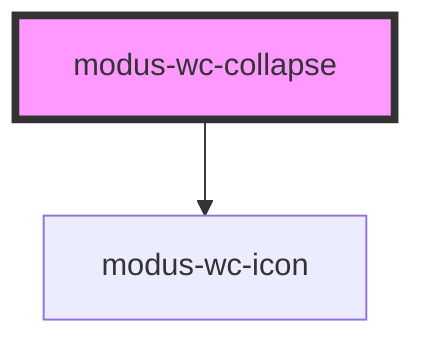

# modus-wc-collapse

## Accessibility

- The collapse is a disclosure built on a native `
` element. The `
` is the toggle and is operated with Enter or Space. It has the id `{collapseId}-title`, and the content panel (`{collapseId}-content`) references it with `aria-labelledby`.
- Use the `header` slot for label content only, such as text or `modus-wc-typography`. Content in the slot is part of the toggle, so don't place buttons, links, or other interactive controls there.
- The summary is not exposed as a heading. It must stay the first child of `
`, so it can't be wrapped in a heading, and heading elements inside it are not reliably announced as headings by screen readers.
- To give a collapse a heading relationship, place a real heading (for example `<h2>`) before it, outside the `
`. For a group of collapses, see the [accordion readme](../modus-wc-accordion/readme.md). If every section must appear as a heading in the page outline, the native `
` pattern can't provide that.
- `collapseId` builds the ids used by `aria-controls` and `aria-labelledby`. A random id is generated when it is not set. If you set it, keep it unique on the page.

<!-- Auto Generated Below -->

## Overview

A customizable collapse component used for showing and hiding content.

The component supports a 'header' and 'content' `<slot>` for injecting custom HTML.

## Properties

| Property          | Attribute          | Description                                                                                                                           | Type                             | Default     |
| ----------------- | ------------------ | ------------------------------------------------------------------------------------------------------------------------------------- | -------------------------------- | ----------- |
| `bordered`        | `bordered`         | When true, renders a border-bottom on the collapse component.                                                                         | `boolean \| undefined`           | `false`     |
| `chevronPosition` | `chevron-position` | Controls chevron placement.                                                                                                           | `"left" \| "right" \| undefined` | `'right'`   |
| `collapseId`      | `collapse-id`      | A unique identifier used to set the id attributes of various elements.                                                                | `string \| undefined`            | `undefined` |
| `customClass`     | `custom-class`     | Custom CSS class to apply to the outer div.                                                                                           | `string \| undefined`            | `''`        |
| `expanded`        | `expanded`         | Controls whether the collapse is expanded or not.                                                                                     | `boolean \| undefined`           | `false`     |
| `options`         | `options`          | Configuration options for rendering the pre-laid out collapse component. Do not set this prop if you intend to use the 'header' slot. | `ICollapseOptions \| undefined`  | `undefined` |

## Events

| Event            | Description                                                 | Type                                  |
| ---------------- | ----------------------------------------------------------- | ------------------------------------- |
| `expandedChange` | Event emitted when the expanded prop is internally changed. | `CustomEvent<{ expanded: boolean; }>` |

## Dependencies

### Depends on

- [modus-wc-icon](../modus-wc-icon)

### Graph

----------------------------------------------

*Built with [StencilJS](https://stenciljs.com/)*
