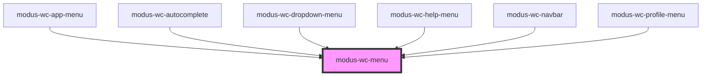

# modus-wc-menu

<!-- Auto Generated Below -->

## Overview

A customizable menu component used to display a list of li elements vertically or horizontally.

The component supports a `<slot>` for injecting custom li elements inside the ul element.

## Properties

| Property          | Attribute         | Description                                                               | Type                                      | Default      |
| ----------------- | ----------------- | ------------------------------------------------------------------------- | ----------------------------------------- | ------------ |
| `bordered`        | `bordered`        | Indicates that the menu should have a border.                             | `boolean \| undefined`                    | `undefined`  |
| `customClass`     | `custom-class`    | Custom CSS class to apply to the ul element.                              | `string \| undefined`                     | `''`         |
| `isSubMenu`       | `is-sub-menu`     | Indicates that this menu is a submenu (dropdown).                         | `boolean \| undefined`                    | `undefined`  |
| `listboxId`       | `listbox-id`      | Id applied to the list element when `popupRole` is `listbox`.             | `string \| undefined`                     | `undefined`  |
| `multiselectable` | `multiselectable` | Sets `aria-multiselectable` when `popupRole` is `listbox`.                | `boolean \| undefined`                    | `false`      |
| `orientation`     | `orientation`     | The orientation of the menu.                                              | `"horizontal" \| "vertical" \| undefined` | `'vertical'` |
| `popupRole`       | `popup-role`      | `menu` keeps menubar/menu semantics. `listbox` is the autocomplete popup. | `"listbox" \| "menu" \| undefined`        | `'menu'`     |
| `selectionMode`   | `selection-mode`  | The selection mode of the menu.                                           | `"multiple" \| "single" \| undefined`     | `'single'`   |
| `size`            | `size`            | The size of the menu.                                                     | `"lg" \| "md" \| "sm" \| undefined`       | `'md'`       |

## Events

| Event                 | Description                                                                                                                    | Type                                             |
| --------------------- | ------------------------------------------------------------------------------------------------------------------------------ | ------------------------------------------------ |
| `menuFocusout`        | Event emitted when the menu loses focus.                                                                                       | `CustomEvent<FocusEvent>`                        |
| `menuSelectionChange` | Event emitted when the selection changes in multiple selection mode. Emits the array of currently selected menu item elements. | `CustomEvent<{ selectedItems: HTMLElement[]; }>` |

## Dependencies

### Used by

 - [modus-wc-app-menu](../modus-wc-app-menu)
 - [modus-wc-autocomplete](../modus-wc-autocomplete)
 - [modus-wc-dropdown-menu](../modus-wc-dropdown-menu)
 - [modus-wc-help-menu](../modus-wc-help-menu)
 - [modus-wc-navbar](../modus-wc-navbar)
 - [modus-wc-profile-menu](../modus-wc-profile-menu)

### Graph

----------------------------------------------

*Built with [StencilJS](https://stenciljs.com/)*
