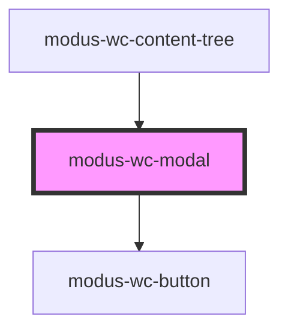

# modus-wc-modal

<!-- Auto Generated Below -->

## Overview

A customizable modal component used to display content in a dialog.

This component supports 'header', 'content', and 'footer' `<slot>` elements for inserting custom HTML.

Open the inner dialog with `showModal()` on the element identified by `modal-id`.
The browser traps focus inside the dialog and restores the element focused before
`showModal()` when the dialog closes, including Escape (WCAG 2.4.3).
This component leaves that behavior to the browser. If your app needs a specific
return target, or the previously focused element is hidden or removed, use a
`close` listener on the inner dialog to focus a logical control, for example:
`dialog.addEventListener('close', () => returnTarget.focus())`.
If the dialog itself is removed, restore focus as part of that removal.

When `aria-label` and `aria-labelledby` are omitted, the dialog name is the header
slot (WCAG 4.1.2). That reference stays on the header, so a title that appears
later is included without rendering the modal again. An `aria-label` or
`aria-labelledby` set on the modal is kept. Put the title in that slot. When the
slot also contains an icon or extra buttons, set `aria-label` or `aria-labelledby`
so the dialog name stays the title.

## Properties

| Property               | Attribute                | Description                                                                                                                | Type                                         | Default     |
| ---------------------- | ------------------------ | -------------------------------------------------------------------------------------------------------------------------- | -------------------------------------------- | ----------- |
| `backdrop`             | `backdrop`               | The modal's backdrop. Specify 'static' for a backdrop that doesn't close the modal when clicked outside the modal content. | `"default" \| "static" \| undefined`         | `'default'` |
| `customClass`          | `custom-class`           | Custom CSS class to apply                                                                                                  | `string \| undefined`                        | `''`        |
| `fullscreen`           | `fullscreen`             | Specifies whether the modal should be displayed full-screen                                                                | `boolean \| undefined`                       | `false`     |
| `modalId` _(required)_ | `modal-id`               | The ID of the inner dialog element                                                                                         | `string`                                     | `undefined` |
| `position`             | `position`               | Specifies the position of the modal                                                                                        | `"bottom" \| "center" \| "top" \| undefined` | `'center'`  |
| `showClose`            | `show-close`             | Specifies whether to show the close icon button at the top right of modal                                                  | `boolean \| undefined`                       | `true`      |
| `showFullscreenToggle` | `show-fullscreen-toggle` | Specifies whether to show the fullscreen toggle icon button                                                                | `boolean \| undefined`                       | `false`     |

## Dependencies

### Used by

 - [modus-wc-content-tree](../modus-wc-content-tree)

### Depends on

- [modus-wc-button](../modus-wc-button)

### Graph

----------------------------------------------

*Built with [StencilJS](https://stenciljs.com/)*
