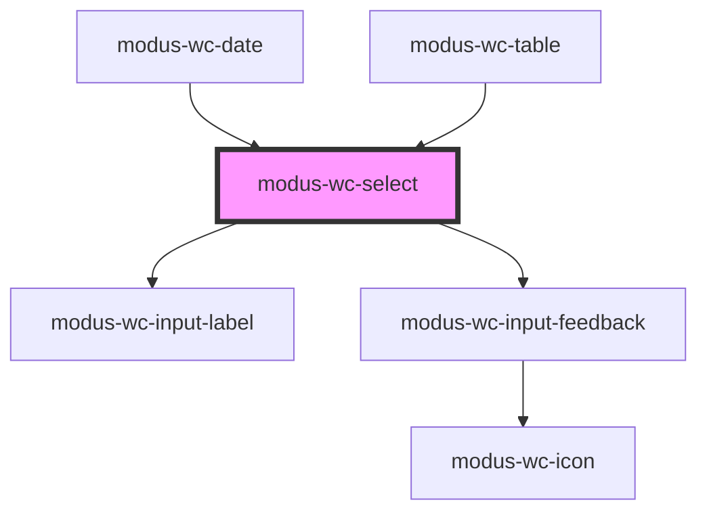

# modus-wc-select

## Allowing users to clear the selection

The select follows native `<select>` behavior: it has no clear button and Escape does not clear it.
To let users reset to no selection, include an option with an empty value that is neither `disabled`
nor `hidden`, for example `{ label: 'None', value: '' }`. Choosing it sets `value` to `''` and emits
`inputChange`.

- Keyboard and pointer users both reach this option natively (arrow keys, type-ahead, Enter, or a click).
- A placeholder such as `{ label: 'Select an account', value: '', disabled: true, hidden: true }`
  cannot be chosen again, so once a value is selected it can't be reset. Use it only when clearing
  is not allowed.
- With `required`, the first empty-value option acts as the placeholder label option. Users can still
  choose it, but the field then fails constraint validation (`valueMissing`).

```js
const select = document.querySelector('modus-wc-select');
select.options = [
  { label: 'None', value: '' },
  { label: 'Option 1', value: '1' },
  { label: 'Option 2', value: '2' },
];
select.value = '2';
```

<!-- Auto Generated Below -->


## Overview

A customizable select component used to pick a value from a list of options

## Properties

| Property        | Attribute         | Description                                                                                             | Type                                                | Default     |
| --------------- | ----------------- | ------------------------------------------------------------------------------------------------------- | --------------------------------------------------- | ----------- |
| `bordered`      | `bordered`        | Indicates that the input should have a border.                                                          | `boolean \| undefined`                              | `true`      |
| `customClass`   | `custom-class`    | Custom CSS class to apply to the inner div.                                                             | `string \| undefined`                               | `''`        |
| `disabled`      | `disabled`        | Whether the form control is disabled.                                                                   | `boolean \| undefined`                              | `false`     |
| `feedback`      | `feedback`        | Feedback to render below the input.                                                                     | `IInputFeedbackProp \| undefined`                   | `undefined` |
| `inputId`       | `input-id`        | The ID of the input element.                                                                            | `string \| undefined`                               | `undefined` |
| `inputTabIndex` | `input-tab-index` | Determine the control's relative ordering for sequential focus navigation (typically with the Tab key). | `number \| undefined`                               | `undefined` |
| `label`         | `label`           | The text to display within the label.                                                                   | `string \| undefined`                               | `undefined` |
| `name`          | `name`            | Name of the form control. Submitted with the form as part of a name/value pair.                         | `string \| undefined`                               | `undefined` |
| `options`       | `options`         | The options to display in the select dropdown.                                                          | `ISelectOption[]`                                   | `[]`        |
| `required`      | `required`        | A value is required for the form to be submittable.                                                     | `boolean \| undefined`                              | `false`     |
| `size`          | `size`            | The size of the input.                                                                                  | `"lg" \| "md" \| "sm" \| "xl" \| "xs" \| undefined` | `'md'`      |
| `value`         | `value`           | The value of the control.                                                                               | `string`                                            | `''`        |


## Events

| Event         | Description                                 | Type                      |
| ------------- | ------------------------------------------- | ------------------------- |
| `inputBlur`   | Event emitted when the input loses focus.   | `CustomEvent<FocusEvent>` |
| `inputChange` | Event emitted when the input value changes. | `CustomEvent<InputEvent>` |
| `inputFocus`  | Event emitted when the input gains focus.   | `CustomEvent<FocusEvent>` |


## Dependencies

### Used by

 - [modus-wc-date](../modus-wc-date)
 - [modus-wc-table](../modus-wc-table)

### Depends on

- [modus-wc-input-label](../modus-wc-input-label)
- [modus-wc-input-feedback](../modus-wc-input-feedback)

### Graph


----------------------------------------------

*Built with [StencilJS](https://stenciljs.com/)*
